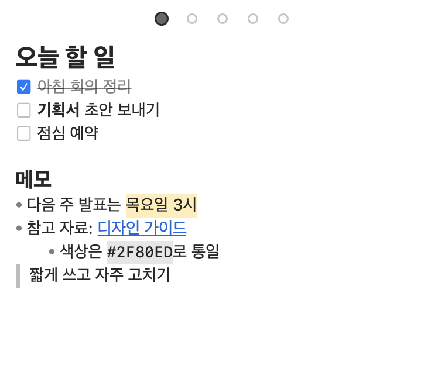

# Memo

메뉴바에 사는 Markdown 메모장. 다른 앱을 눌러도 위에 떠 있고(설정에서 끌 수 있다), 메뉴바 아이콘이나 단축키로 여닫는다.



## 설치

macOS 14(Sonoma) 이상, Apple Silicon·Intel 모두 된다. 내 Mac에서 직접 빌드하므로 Xcode Command Line Tools가 필요하다. 없으면 먼저 설치한다.

```sh
xcode-select --install
```

이 저장소를 내려받고(`git clone` 또는 위쪽 초록색 Code 버튼 → Download ZIP) 그 폴더에서 아래를 실행하면 `/Applications/Memo.app`에 설치되고 바로 켜진다. 새 버전을 받았을 때도 똑같이 실행하면 된다.

```sh
sh build.sh
```

## 사용법

- 메뉴바 아이콘 클릭: 메모 열기·닫기
- 메뉴바 아이콘 오른쪽 클릭: 설정, Markdown 도움말, 종료
- Markdown이 처음이면 도움말(⇧⌘/)을 연다. 기호를 치면 어떻게 보이는지 나란히 보여주고, 그 창에서 직접 연습할 수 있다 (저장되지 않음)
- 설정에서 어느 앱에서든 메모를 여는 단축키를 지정할 수 있다 (처음엔 없음). 글꼴, 다른 앱 위에 항상 표시할지도 설정에서 고른다
- 창은 위쪽 빈 곳을 끌어서 옮기고, 가장자리로 크기를 바꾼다
- 메모는 5개. 위쪽 점을 누르거나 ⌘1~⌘5로 바꾼다. 채운 점은 내용 있는 메모, 빈 고리는 빈 메모, 크고 진한 점이 지금 메모

| 기능 | 기본 단축키 |
|---|---|
| 설정 열기 | ⌘, |
| Markdown 도움말 | ⇧⌘/ |
| 찾기 | ⌘F |
| 메모 1~5 전환 | ⌘1~⌘5 |
| 굵게 / 기울임 / 취소선 / 하이라이트 | ⌘B / ⌘I / ⇧⌘X / ⇧⌘H |
| 체크박스 만들기·체크 | ⌘L |
| 글자 크게 / 작게 | ⌘= / ⌘- |
| 목록 들여쓰기 / 내어쓰기 | Tab / ⇧Tab |
| 줄 위로 / 아래로 옮기기 | ⌥↑ / ⌥↓ |
| 줄 복사 / 잘라내기 (선택 없을 때) | ⌘C / ⌘X |

단축키는 설정에서 모두 바꿀 수 있다.

지원하는 Markdown: `#`~`###` 제목, `- ` 목록, `1. ` 번호 목록, `- [ ]` 체크박스, `> ` 인용, `**굵게**`, `*기울임*`, `~~취소선~~`, `==하이라이트==`, `` `코드` ``, ```` ``` ```` 코드 블록, `[글자](주소)` 링크, `---` 구분선.

- 목록·인용 끝에서 Enter를 치면 다음 줄에 같은 기호(번호는 다음 번호)가 이어지고, 빈 줄에서 한 번 더 치면 기호가 지워진다
- 링크와 본문의 URL은 ⌘+클릭으로 연다
- `(` `[` `{` `` ` ``는 닫는 짝이 같이 들어간다. 글자를 선택하고 치면 감싼다 (`*` `~` `=`도)

## 저장 위치

`~/Documents/Memo/1.md`~`5.md`. 입력하는 대로 저장된다. Memo가 켜져 있는 동안 다른 앱에서 이 파일을 고치면 Memo에 입력할 때 덮어써진다.

## 삭제

메뉴바 아이콘 오른쪽 클릭 → 종료 후 `/Applications/Memo.app`을 지운다. 메모는 위 저장 위치에 남는다.
